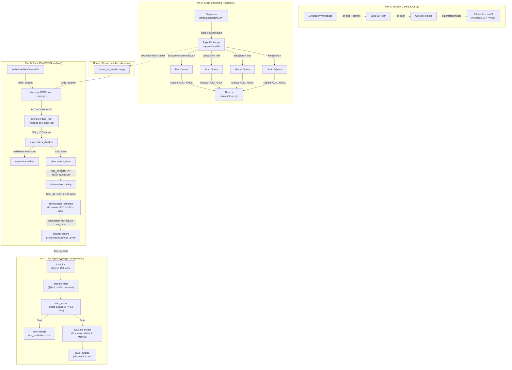

# FreshCart Pipelines: From Git to Gold

[](https://github.com/MrinalKarmokar/freshcart-pipelines/actions/workflows/ci.yml)
[](https://www.python.org/downloads/)
[](https://www.snowflake.com/)
[](https://www.mage.ai/)
[](https://www.rabbitmq.com/)

An end-to-end modern data engineering platform demonstrating:
1. **Version Control & CI/CD** — Git 4-stage workflow and automated GitHub Actions testing.
2. **Lakehouse ELT Pipeline** — Medallion architecture on Snowflake (Bronze $\rightarrow$ Silver $\rightarrow$ Quarantine $\rightarrow$ Gold SCD2).
3. **ML Pipeline Orchestration** — Modular Scikit-Learn decision tree classifier with Mage quality gates and evaluation branches.
4. **Real-time Event Streaming** — Topic-based dispatch system with RabbitMQ and resilient ACK/NACK consumer handling.
5. **Stream into the Lakehouse (Bonus)** — Micro-batch streaming consumer loading streaming events directly into Snowflake with verified idempotency.

---

## Architecture Overview



---

## Repository Structure

```
freshcart-pipelines/
├── .github/
│   └── workflows/
│       └── ci.yml                     # GitHub Actions CI workflow (Python 3.12)
├── elt/
│   └── freshcart_elt.ipynb            # Snowflake ELT Lakehouse notebook (Parts B1–B5)
├── iris_project/                      # Mage ML Pipeline project (Parts C1–C4)
│   ├── data_loaders/
│   │   └── load_iris.py               # Loads Iris dataset with 150-row validation test
│   ├── transformers/
│   │   ├── prepare_data.py            # 80/20 train/test split transformer
│   │   ├── train_model.py             # Decision tree training with quality gate test (>= 0.8)
│   │   └── evaluate_model.py          # Confusion matrix & multi-metric evaluation
│   ├── data_exporters/
│   │   ├── save_results.py            # Exports test predictions to iris_predictions.csv
│   │   └── save_metrics.py            # Exports evaluation metrics to iris_metrics.csv (C4)
│   └── pipelines/iris_classifier/
│       └── metadata.yaml              # Pipeline DAG wiring with branched execution
├── stream/                            # RabbitMQ Event Streaming (Parts D1–D3 & Bonus)
│   ├── dispatcher.py                  # Order dispatcher publishing to rapido-dispatch topic
│   ├── driver.py                      # Driver consumer with topic binding and manual ACK/NACK
│   ├── stream_demo.ipynb              # Executable Colab notebook demonstrating full stream
│   └── stream_to_lakehouse.py         # Bonus: 60s micro-batch streamer into Snowflake
├── tests/
│   ├── conftest.py                    # Pytest environment discovery configuration
│   └── test_prepare_data.py           # Automated unit test verifying 80/20 data split (A3)
├── .gitignore                         # Comprehensive ignore rules for credentials & artifacts
├── pyproject.toml                     # Modern uv project configuration & pytest options
├── requirements.txt                   # Standard pip dependencies for reproduction
└── README.md                          # Platform documentation
```

---

## Quick Start & Installation

### Option 1: Using `uv` (Recommended)
```bash
# 1. Clone repository
git clone https://github.com/MrinalKarmokar/freshcart-pipelines.git
cd freshcart-pipelines

# 2. Create virtual environment & sync dependencies
uv venv
uv sync

# 3. Activate virtual environment
# On Windows (PowerShell):
.venv\Scripts\activate
# On Linux / macOS:
source .venv/bin/activate
```

### Option 2: Using standard `pip`
```bash
python -m venv .venv
source .venv/bin/activate  # or .venv\Scripts\activate on Windows
pip install -r requirements.txt
```

---

## Component Walkthrough

### Part A: Git & CI/CD
* **4-Box Flow:** Demonstrates how source code transitions through `Working Folder` $\rightarrow$ `Staging Area` $\rightarrow$ `Local Repository` $\rightarrow$ `Remote GitHub + CI`.
* **Automated CI:** Runs on every push via `.github/workflows/ci.yml`. Tests `tests/test_prepare_data.py` across Python 3.12:
  ```bash
  pytest tests/ -v
  ```

### Part B: FreshCart ELT on Snowflake
Located in [`elt/freshcart_elt.ipynb`](elt/freshcart_elt.ipynb):
* **Bronze:** Raw immutable ingest (`bronze.orders_raw`) storing payload envelopes.
* **Silver:** Cleansing, currency standardisation, regex validation, and deduplication (`QUALIFY ROW_NUMBER()`). Bad rows routed to `quarantine.orders`.
* **Gold:** Point-in-time SCD Type 2 customer tier enrichment, FX conversion, regional mapping, and strictly idempotent `MERGE` on `row_hash`.
* **Execution:**
  ```python
  # Run in Google Colab or local Jupyter with Snowflake credentials
  run_pipeline()
  quality_checks()
  ```

### Part C: ML Pipeline with Mage
Located in [`iris_project/`](iris_project/):
* **Quality Gate:** `train_model` evaluates accuracy against a threshold (`accuracy >= 0.8`). If underfitting occurs (`max_depth = 1`), execution halts and bad predictions are never exported.
* **Evaluation Branch:** Fans out from `train_model` into both `save_results` and `evaluate_model` in parallel.
* **Running Mage locally or in Colab:**
  ```bash
  mage run iris_project iris_classifier --test
  ```

### Part D: Food-Order Stream with RabbitMQ
Located in [`stream/`](stream/):
* **Dispatcher:** Publishes random orders every 2 seconds to the `rapido-dispatch` topic exchange (`city.zone.type`). Intentionally sends malformed orders (missing `zone`) every 10th message.
* **Driver Consumers:** Bind queues using topic wildcards (`*` single-word, `#` multi-word):
  ```bash
  python stream/driver.py Ravi "bangalore.koramangala.*"
  python stream/driver.py Arjun "bangalore.*.ride"
  python stream/driver.py Meena "bangalore.*.food"
  python stream/driver.py Control "bangalore.#"
  ```
* **ACK / NACK Resilience:** Malformed orders without `zone` are rejected via `basic_nack(requeue=False)` to prevent poison-pill loops; valid orders receive `basic_ack()`.
* **Interactive Demo:** Open and run [`stream/stream_demo.ipynb`](stream/stream_demo.ipynb) in Colab.

### Bonus: Stream into the Lakehouse (+10 marks)
Located in [`stream/stream_to_lakehouse.py`](stream/stream_to_lakehouse.py):
* Collects live stream orders from RabbitMQ for a 60-second micro-batch window.
* Packages raw payloads via `write_landing()` and loads into Snowflake `bronze.orders_raw`.
* Promotes through Silver and merges into `gold.fct_orders`.
* **Idempotency Proof:** Re-running the identical batch appends to Bronze but results in zero duplicate rows and zero revenue distortion in Gold.

---

## Verification & Tests

To execute the local test suite:
```bash
pytest tests/ -v
```

Expected output:
```
tests/test_prepare_data.py::test_split_is_80_20 PASSED                   [100%]
============================== 1 passed in 0.15s ==============================
```

---

## Author
* **Student:** Mrinal Karmokar
* **Institution:** IIITDM Jabalpur
* **Course:** Data Engineering · Semester 1
