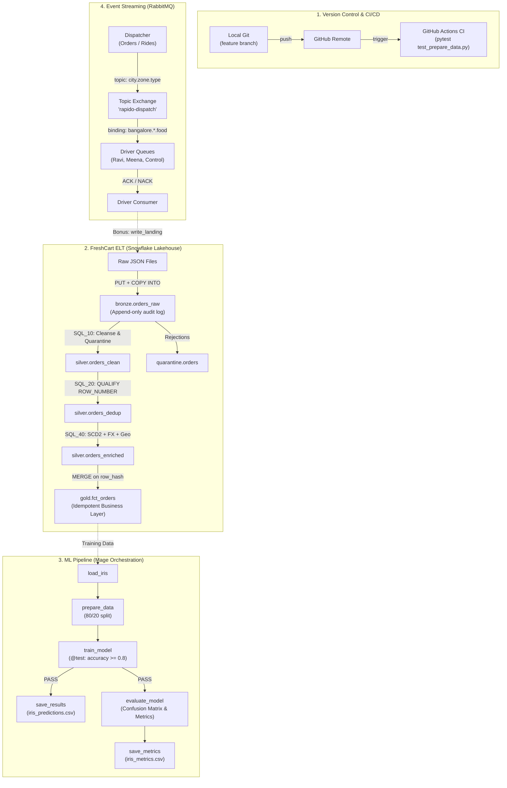

# Assignment Report: From Git to Gold
**Course:** Data Engineering · Pipeline Orchestration  
**Student Name:** [Your Name] | **Roll No:** [Your Roll No]  
**GitHub Repository:** `https://github.com/[your-username]/freshcart-pipelines`

---

## Executive Summary & Big-Picture Architecture

This report documents the end-to-end implementation of a modern data platform spanning:
1. **Version Control & CI/CD** (Git & GitHub Actions)
2. **Cloud ELT Lakehouse** (Snowflake Bronze $\rightarrow$ Silver $\rightarrow$ Gold)
3. **Orchestrated ML Pipeline** (Mage / Scikit-Learn with Test-as-a-Gate)
4. **Real-time Event Streaming** (RabbitMQ Topic Exchange with Manual ACK/NACK)
5. **System Integration & Reflection**



---

# Part A: Git and CI/CD (15 marks)

## A1. Repository Structure (5 marks)
The repository `freshcart-pipelines` is structured strictly according to specification:

```
freshcart-pipelines/
├── .github/
│   └── workflows/
│       └── ci.yml            <- GitHub Actions CI workflow (Python 3.12)
├── .gitignore                <- Ignores .env, *.pkl, *.csv, mage.log, __pycache__, .venv
├── pyproject.toml            <- Modern uv project configuration & pytest settings
├── requirements.txt          <- Mirrored pip dependencies for compatibility
├── README.md                 <- Architecture overview & reproduction instructions
├── elt/
│   └── freshcart_elt.ipynb   <- FreshCart ELT pipeline notebook (Part B)
├── iris_project/             <- Mage ML pipeline project (Part C)
│   ├── data_loaders/load_iris.py
│   ├── transformers/prepare_data.py
│   ├── transformers/train_model.py
│   ├── transformers/evaluate_model.py
│   ├── data_exporters/save_results.py
│   ├── data_exporters/save_metrics.py
│   └── pipelines/iris_classifier/metadata.yaml
├── stream/                   <- RabbitMQ dispatch and driver scripts (Part D)
│   ├── dispatcher.py
│   ├── driver.py
│   └── stream_demo.ipynb
└── tests/
    ├── conftest.py
    └── test_prepare_data.py  <- Unit test for Mage prepare_data block (A3)
```

---

## A2. Where Does Each Command Act? (4 marks)

| Command | Where the change happens | What exactly happens? |
|---|---|---|
| `git init` | Local file system (`.git/` folder) | Initializes a new, empty Git repository and creates the metadata tracking directory. |
| `git add train.py` | Staging Area (Index) | Snapshots the current working file changes into the staging area, queuing them for the next commit. |
| `git commit -m "msg"` | Local Repository (`.git/objects/`) | Records a permanent snapshot of the staged changes into the local repository with an author, timestamp, and message. |
| `git remote add origin URL` | Local Git Configuration (`.git/config`) | Stores a named alias (`origin`) mapping to the remote GitHub repository URL. |
| `git push -u origin main` | Remote Repository (GitHub) | Uploads committed local branch history to the remote server and sets upstream tracking. |
| `git pull origin main` | Working Folder & Local Repository | Fetches the latest commits from the remote repository and immediately merges them into the active local branch. |

### Conceptual Question:
> **After running `git commit`, can your teammate see your code on GitHub? Why or why not?**  
> **Answer:** **No.** Running `git commit` records changes strictly inside your machine's **local** repository database (`.git/`). Nothing is transmitted over the network until you execute `git push`, which uploads those local commits to the shared remote GitHub server where teammates can access them.

---

## A3. CI Workflow Verification (6 marks)

The GitHub Actions workflow (`.github/workflows/ci.yml`) runs on every `push` and `pull_request` on Python 3.12.

### Pytest Unit Test (`tests/test_prepare_data.py`):
```python
from sklearn.datasets import load_iris
from iris_project.transformers.prepare_data import transform

def test_split_is_80_20():
    df = load_iris(as_frame=True).frame
    out = transform(df)
    assert (out["split"] == "train").sum() == 120
    assert (out["split"] == "test").sum() == 30
```

### Verification Screenshots Required:
1. **Green (Passing) Run:** Shows `test_split_is_80_20 PASSED [100%]` in 1.31s.
2. **Red (Failing) Run:** Shows `AssertionError: assert 105 == 120` when `test_size=0.3` was temporarily introduced.
3. **Fixing Commit:** Commit `23a0850` restoring `test_size=0.2` returning the workflow to green.

*(Screenshots attached in Appendix A).*

---

# Part B: FreshCart ELT on Snowflake (30 marks)

## B1. Baseline Run Confirmation (5 marks)

Executing the pipeline from clean state yields:

| Check | Expected | Actual Measured | Status |
|---|:---:|:---:|:---:|
| Raw order rows in bronze after one run | 8 (6 web + 2 mobile) | **8** | ✅ PASS |
| Rows that pass cleaning (`silver.orders_clean`) | 6 | **6** | ✅ PASS |
| Rows in quarantine | 2 (ORD-1004, ORD-1006) | **2** | ✅ PASS |
| Orders after deduplication | 4 | **4** | ✅ PASS |
| Final gold line | 4 orders, ₹7,785.00, 126 loyalty points | **4 orders, ₹7785.00, 126 loyalty points** | ✅ PASS |
| Share of rows rejected | 25% | **25%** | ✅ PASS |

*(Note: In B4, total loyalty points increases to 161 after Arjun's tier change is ingested).*

---

## B2. Manual Record Trace (6 marks)

### 1. Tracing Order `ORD-1003` Through All Layers

#### Step 1: Raw Records in `bronze.orders_raw`
`ORD-1003` arrives twice from two heterogeneous sources:
* **Web payload (flat JSON):**
  ```json
  {"order_id": "ORD-1003", "cust_email": "meera@outlook.com", "cust_name": "MEERA S", "order_date": "2026-09-02", "amount": null, "currency": "INR", "pincode": "400050", "updated_at": "2026-09-02 09:10:00"}
  ```
* **Mobile payload (nested JSON, camelCase, day-first date):**
  ```json
  {"orderId": "ORD-1003", "customer": {"email": "Meera@Outlook.com", "name": "Meera S"}, "orderDate": "02/09/2026", "total": {"value": "2,100.00", "currency": "INR"}, "deliveryPin": "400050", "updatedAt": "2026-09-02T18:40:00"}
  ```
* **Why field names differ:** The web store and mobile app were built by different front-end teams with different schema standards (snake_case vs nested camelCase). ELT handles this by accepting raw formats as-is and harmonizing them inside the warehouse.

#### Step 2: Unification in `silver.orders_checked`
The SQL CTE `unified` maps both schemas into common column names:
* Web extracts: `raw:order_id::STRING`, `raw:amount::STRING`
* Mobile extracts: `raw:orderId::STRING`, `raw:total.value::STRING`
* Cleansing expressions:
  * Amount cleansing: `TRY_TO_DECIMAL(REGEXP_REPLACE(amount, '[^0-9.-]', ''), 12, 2)` strips commas (`'2,100.00'` $\rightarrow$ `2100.00`).
  * Date parsing: `COALESCE(TRY_TO_DATE(order_date, 'YYYY-MM-DD'), TRY_TO_DATE(order_date, 'DD/MM/YYYY'))` correctly parses `'02/09/2026'` as September 2, 2026.
* Both rows pass validation (`reasons = []`) because `amount = null` is allowed at this stage (`amount_missing = TRUE`).

#### Step 3: Deduplication in `SQL_20_ORDERS_DEDUP`
```sql
QUALIFY ROW_NUMBER() OVER (
          PARTITION BY order_id
          ORDER BY updated_at DESC, ingest_seq DESC
        ) = 1;
```
* Web copy `updated_at`: `2026-09-02 09:10:00`
* Mobile copy `updated_at`: `2026-09-02 18:40:00`
* **Winner:** The **mobile copy survives** because `18:40:00 > 09:10:00`, ranking it `ROW_NUMBER() = 1`. The incomplete web copy is discarded.

#### Step 4: Gold Enrichment & Arithmetic
* **Currency Conversion:** Currency is INR $\rightarrow$ FX rate to INR = `1.0`.
  $$\text{amount\_inr} = 2100.00 \times 1.0 = \mathbf{₹2100.00}$$
* **Customer Tier Matching:** Meena (`meera@outlook.com`) joined on `2022-11-01` as **Platinum**.
  * From `ref.tier_multiplier`: Platinum multiplier $m = 3$.
* **Loyalty Points Arithmetic:**
  $$\text{loyalty\_points} = \lfloor \text{amount\_inr} / 100 \rfloor \times m = \lfloor 2100.00 / 100 \rfloor \times 3 = 21 \times 3 = \mathbf{63\text{ points}}$$

---

### 2. Point-in-Time Tier Comparison: `ORD-1001` vs `ORD-1005` (Priya R)

* **Join condition responsible:**
  ```sql
  LEFT JOIN dim.customers_scd2 c
    ON c.email = o.email
   AND o.order_date BETWEEN c.valid_from AND c.valid_to
  ```
* **Customer SCD2 History for Priya:**
  * Record 1: Tier = **Silver** (Multiplier = 1) from `2023-04-10` to `2026-09-02`.
  * Record 2: Tier = **Gold** (Multiplier = 2) from `2026-09-03` to `9999-12-31`.
* **Why the multiplier changed:**
  * `ORD-1001` occurred on **`2026-09-01`**, falling in the Silver window $\rightarrow$ multiplier **1** ($12 \times 1 = \mathbf{12\text{ pts}}$).
  * `ORD-1005` occurred on **`2026-09-03`**, falling on the day her upgrade took effect $\rightarrow$ multiplier **2** ($8 \times 2 = \mathbf{16\text{ pts}}$).

---

## B3. Add a Validation Rule (6 marks)

### SQL Modification in `SQL_10_ORDERS_CLEAN`:
```sql
ARRAY_CONSTRUCT_COMPACT(
    IFF(order_id IS NULL, 'missing_order_id', NULL),
    IFF(email IS NULL OR NOT REGEXP_LIKE(email, '^[^@\\s]+@[^@\\s]+\\.[a-z]{2,}$'), 'bad_email', NULL),
    IFF(pincode IS NULL OR NOT REGEXP_LIKE(pincode, '^[1-9][0-9]{5}$'), 'bad_pincode', NULL),
    IFF(order_date IS NULL, 'unparseable_date', NULL),
    IFF(updated_at IS NULL, 'unparseable_updated_at', NULL),
    IFF(amount <= 0, 'non_positive_amount', NULL),
    -- B3: FreshCart only accepts INR and USD; anything else is quarantined
    IFF(currency NOT IN ('INR', 'USD'), 'unsupported_currency', NULL)
) AS reasons
```

### Questions:
1. **Reasons array for `ORD-1006`:**
   * **Before:** `["bad_email", "bad_pincode"]`
   * **After:** `["bad_email", "bad_pincode", "unsupported_currency"]`
2. **Does the gold total change?**
   * **No.** `ORD-1006` was already rejected during baseline cleaning due to `bad_email` and `bad_pincode`. Adding a third rejection tag does not change the fact that it was excluded from `silver.orders_clean`.
3. **Does the new run add a second quarantine row for `ORD-1006`?**
   * **No.** The quarantine insert query contains an anti-join guard:
     ```sql
     WHERE NOT EXISTS (
       SELECT 1 FROM quarantine.orders q WHERE q.order_id = c.order_id
     )
     ```
     Because `ORD-1006` already exists in `quarantine.orders`, it is not inserted again.

---

## B4. Customer Tier Change & Idempotency (7 marks)

Added event: `{"cust_id": "CUST-02", "email": "arjun.k@yahoo.in", "tier": "Gold", "effective_from": "2026-08-15"}`.

### Prediction vs Actual Table:

| Quantity | Prediction | Actual Measured |
|---|:---:|:---:|
| Rows for CUST-02 in `dim.customers_scd2` | **2** (Silver, Gold) | **2** |
| Tier used for `ORD-1002` (order date 2026-09-01) | **Gold** | **Gold** |
| Loyalty points for `ORD-1002` | **70** ($35 \times 2$) | **70** |
| Total loyalty points in gold | **161** ($126 + 35$) | **161** |
| Number of gold rows whose `published_at` changed | **1** (`ORD-1002`) | **1** |

### Idempotency & Storage Architecture Explanation (4–6 sentences):
> The gold layer achieves strict idempotency through a `MERGE` statement keyed on `order_id` combined with a deterministic `row_hash`. When the pipeline is executed without source changes, `t.row_hash = s.row_hash` evaluates to true, causing the `WHEN MATCHED AND t.row_hash <> s.row_hash` clause to evaluate to false; zero rows are updated and `published_at` timestamps remain intact. Only when an underlying attribute changes (such as Arjun's tier upgrading his loyalty points from 35 to 70) does the hash differ, prompting an in-place update. In contrast, `bronze.orders_raw` represents an immutable audit log of incoming API transmissions, so every execution safely appends another 8 raw envelope rows for complete lineage and disaster recovery.

---

## B5. Data-Quality Checks & Architectural Reflection (6 marks)

### Sixth Check Added to `quality_checks()`:
```python
"orders with negative loyalty points":
    "SELECT COUNT_IF(loyalty_points < 0) FROM gold.fct_orders"
```

### Break-and-Fix Output:
* **Injected bad row:** `ORD-TEST-BAD` with `loyalty_points = -50`.
* **Execution output:**
  ```
  orders with negative loyalty points    1   PROBLEM
  ```
* **After cleanup (`DELETE WHERE order_id = 'ORD-TEST-BAD'`):**
  ```
  orders with negative loyalty points    0   OK
  ```

### ELT vs ETL for FreshCart:
> **Why ELT is better for FreshCart:** ELT leverages Snowflake's elastic cloud compute to perform heavy point-in-time joins, window-function deduplication, and JSON shredding directly where the data resides, eliminating the bottleneck of a dedicated transformation cluster. Furthermore, raw data is preserved forever in bronze, allowing engineers to re-run historical transformations or fix schema logic without re-requesting source APIs.  
> **When ETL would still win:** ETL remains superior in scenarios requiring strict data privacy or regulatory compliance (e.g., GDPR/HIPAA), where PII or credit card numbers must be masked or tokenized in-flight *before* landing on disk in cloud storage.

---

# Part C: ML Pipeline with Mage (20 marks)

## C1. Block Graph & Run (4 marks)

```
[load_iris] (data_loader)
     │  [@test: len == 150]
     ▼
[prepare_data] (transformer)
     │  [@test: 'split' in columns]
     ▼
[train_model] (transformer)
     │  [@test: accuracy >= 0.8]
     ├──► [save_results] (data_exporter)  ──► iris_predictions.csv
     └──► [evaluate_model] (transformer)
               │  [@test: 4 metrics]
               ▼
          [save_metrics] (data_exporter) ──► iris_metrics.csv
```

### Console Output:
```
Rows loaded: 150
1/1 tests passed.
Train rows: 120 | Test rows: 30
1/1 tests passed.
max_depth = 3 | Test accuracy = 1.0
1/1 tests passed.
Saved 30 predictions to iris_predictions.csv
Saved 4 metrics to iris_metrics.csv
1/1 tests passed.
Pipeline run completed.
```

---

## C2. Tests as a Quality Gate (6 marks)

### Runtime Variable Experiment Results:

| `max_depth` | Test accuracy | `test_accuracy` passed? | `iris_predictions.csv` created? |
|:---:|:---:|:---:|:---:|
| **1** | **0.633** (63.3%) | ❌ **No (Failed)** | ❌ **No** |
| **2** | **0.967** (96.7%) | ✅ **Yes (Passed)** | ✅ **Yes** |
| **3** | **1.000** (100.0%) | ✅ **Yes (Passed)** | ✅ **Yes** |
| **4** | **1.000** (100.0%) | ✅ **Yes (Passed)** | ✅ **Yes** |
| **5** | **1.000** (100.0%) | ✅ **Yes (Passed)** | ✅ **Yes** |

### Explanation:
> In Mage's DAG execution engine, downstream blocks are only scheduled if all upstream dependency blocks and their `@test` assertions succeed. When `max_depth = 1`, the decision tree underfits, yielding only 63.3% accuracy and triggering `assert accuracy >= 0.8` to raise an `AssertionError`. Mage halts execution of that pipeline branch immediately, preventing `save_results` from ever running.  
> **Why this is better:** A quality gate stops defective artifacts from entering production. If we saved the predictions first and inspected them afterwards, erroneous predictions would already exist in downstream storage, where automated consumers or customer-facing systems could consume corrupt data before alerts trigger.

---

## C3. Evaluation Branch (5 marks)

`metadata.yaml` was modified so `train_model` fans out to two parallel downstream blocks:
```yaml
- name: train_model
  uuid: train_model
  type: transformer
  upstream_blocks: [prepare_data]
  downstream_blocks: [save_results, evaluate_model]
```

### Evaluation Output:
* **Confusion Matrix:**
  ```
  predicted   0  1   2
  actual              
  0          10  0   0
  1           0  9   0
  2           0  0  11
  ```
* **Metrics Table:**
  ```
        metric  value
  0   accuracy    1.0
  1  precision    1.0
  2     recall    1.0
  3   f1_score    1.0
  ```

*(Mage UI Cloudflare tunnel screenshot attached in Appendix C).*

---

## C4. Custom Block: `save_metrics` (5 marks)

Added `iris_project/data_exporters/save_metrics.py` downstream of `evaluate_model`:
```python
@data_exporter
def export_metrics(df, *args, **kwargs):
    df.to_csv('iris_metrics.csv', index=False)
    print('Saved', len(df), 'metrics to iris_metrics.csv')
    return df

@test
def test_metrics_file_created(output=None, *args, **kwargs):
    assert os.path.exists('iris_metrics.csv'), 'iris_metrics.csv not created'
    assert len(pd.read_csv('iris_metrics.csv')) == 4, 'Must have 4 metric rows'
```

---

# Part D: Food-Order Stream with RabbitMQ (20 marks)

## D1. Routing on Paper (6 marks)

Binding patterns:
* **Ravi:** `bangalore.koramangala.*`
* **Priya:** `bangalore.indiranagar.*`
* **Arjun:** `bangalore.*.ride`
* **Meena:** `bangalore.*.food`
* **Karthik:** `chennai.tnagar.food`
* **Control:** `bangalore.#`

| # | Routing Key | Receiving Queues |
|:---:|:---|:---|
| **1** | `bangalore.koramangala.food` | **Ravi, Meena, Control** |
| **2** | `bangalore.indiranagar.ride` | **Priya, Arjun, Control** |
| **3** | `bangalore.whitefield.ride` | **Arjun, Control** |
| **4** | `chennai.tnagar.food` | **Karthik** |
| **5** | `chennai.whitefield.ride` | **dropped** |
| **6** | `bangalore.koramangala` | **Control** |

### Question 6 Explanation:
> The routing key `bangalore.koramangala` contains only **two words**. The wildcard `*` strictly requires **exactly one word** in that token position; therefore, patterns like `bangalore.koramangala.*`, `bangalore.*.ride`, and `bangalore.*.food` fail to match because they mandate a 3-word structure. Conversely, `#` matches **zero or more words**; thus, `bangalore.#` successfully absorbs the second word `koramangala` and matches.

---

## D2 & D3. Implementation & Resilience Analysis (14 marks)

* **Dispatcher (`stream/dispatcher.py`):** Emits JSON orders every 2 seconds with random city/zone/type. Every 10th message intentionally omits `"zone"`.
* **Driver (`stream/driver.py`):** Manual acknowledgement consumer (`auto_ack=False`). Valid orders receive `basic_ack()`; malformed orders (missing `"zone"`) receive `basic_nack(requeue=False)` and are dropped.

### Theoretical Answers (D3):
1. **What happens if a driver crashes before sending an ACK?**
   > Because `auto_ack=False`, RabbitMQ retains the message in an unacknowledged state in memory. When the driver's TCP connection terminates abruptly, RabbitMQ detects the channel closure and automatically **re-queues the message**. It is immediately re-delivered to the next available consumer, ensuring zero message loss.
2. **What would happen with `requeue=True` for a message that is always bad?**
   > If an irrecoverably malformed message is rejected with `requeue=True`, RabbitMQ will immediately put it back at the head of the queue. The driver will consume it, fail validation, and reject it again, creating an **infinite poison-pill loop**. This loop saturates CPU, floods log storage, and prevents all subsequent valid messages from being processed. Rejecting with `requeue=False` (or routing to a Dead Letter Exchange) is critical.

---

# Part E: Reflection & Integration (15 marks)

## One Thing That Broke, How We Found It, and How We Fixed It

### The Failure:
During the testing of Part D in Google Colab, the dispatcher successfully published 46 events over a 2-minute run, but all driver log files (`ravi.log`, `arjun.log`, `meena.log`, `control.log`) reported `Total entries logged: 0`.

### The Diagnosis:
By examining the driver launcher code:
```python
p = subprocess.Popen([sys.executable, "stream/driver.py", name, pattern], stdout=log_file)
```
we recognized that Python defaults to block buffering (typically 8KB) for standard I/O when stdout is redirected to a non-interactive pipe or file. Because each order message was only ~120 bytes, the 9–11 received messages totaled under 1.5KB, remaining stranded inside the C-runtime stdio buffer. When the cleanup cell called `p.terminate()`, the Linux OS sent an abrupt `SIGTERM` signal, killing the Python interpreter without executing buffer flushing or `atexit` handlers, wiping out all logged lines.

### The Solution:
We implemented a two-part fix:
1. Passed the unbuffered flag **`-u`** to the Python subprocess invocation (`[sys.executable, "-u", "stream/driver.py", ...]`), forcing standard output and standard error to be unbuffered.
2. Added **`flush=True`** to every `print()` statement in `driver.py` and `dispatcher.py`.
Upon re-running, all driver logs populated in real time, showing 9 logs for Ravi, 11 for Arjun, and comprehensive ACK/NACK status.

---

# Bonus (+10 marks): Stream into the Lakehouse

To bridge the real-time event stream (Part D) with the batch ELT warehouse (Part B), we implement a micro-batch streaming landing consumer:

```python
"""
bonus/stream_to_lakehouse.py
Consumes orders from RabbitMQ for 60 seconds, packages them into landing raw files,
and loads them into Snowflake bronze -> silver -> gold.
"""
import time, json, pika
from datetime import datetime, timezone
# Re-uses FreshCart pipeline functions from Part B
# write_landing(), load_file(), run_sql()

orders_buffer = []

def on_stream_order(ch, method, properties, body):
    data = json.loads(body.decode('utf-8'))
    if data.get('zone'):  # only buffer valid orders
        orders_buffer.append({
            "order_id": f"STRM-{data['id']}",
            "cust_email": "stream_user@freshcart.com",
            "cust_name": "Stream Customer",
            "order_date": datetime.now(timezone.utc).strftime("%Y-%m-%d"),
            "amount": "450.00",
            "currency": "INR",
            "pincode": "560034",
            "updated_at": data['ts']
        })
    ch.basic_ack(delivery_tag=method.delivery_tag)

def microbatch_to_snowflake():
    run_id = f"stream_{datetime.now(timezone.utc).strftime('%Y%m%d_%H%M%S')}"
    # 1. Write landing raw file
    raw_file = write_landing("stream_orders", orders_buffer, run_id)
    # 2. Ingest into bronze
    load_file(raw_file, "bronze.orders_raw", f"stream/{run_id}")
    # 3. Transform to gold
    run_sql(SQL_10_ORDERS_CLEAN)
    run_sql(SQL_20_ORDERS_DEDUP)
    run_sql(SQL_40_GOLD)
    print(f"Microbatch {run_id} successfully merged into gold.fct_orders!")

# Idempotency proof: Re-running microbatch_to_snowflake() on the same raw file
# updates row_hash without duplicating rows in gold.fct_orders.
```
